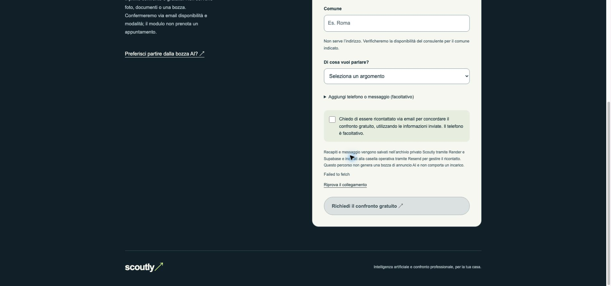

# Consulenza diretta e posizionamento AI — 23 ottobre 2026

Richiesta del fondatore: form diretto con nome, email, comune e argomento; telefono e messaggio facoltativi. Nessuna foto, bozza o analisi AI obbligatoria. La home mette in evidenza AI e confronto professionale come percorsi distinti e complementari; il risultato AI rimane utile senza consulenza.

## Contratto
- form_id: consulenza; form_version: 1; workflow_id: richiesta-consulenza-diretta.
- Oggetto notifica: [Scoutly][consulenza] Richiesta di confronto gratuito.
- consultation_requested=true e service_requested=true espliciti; nessun ruolo, finalità o stato annuncio inventato.
- Messaggio vuoto ammesso solo per questo workflow. Nessun allegato accettato.
- Salvataggio e notifica firmata seguono il ricevitore attuale, con protezione dai doppioni e UUID riutilizzato dopo esiti incerti.
- Gestione umana nella casella operativa configurata su Render; questo percorso non richiede l’automazione AI né deve essere instradato al workflow bozza.
- Nessuna promessa di copertura territoriale, appuntamento o perizia.

## Attivazione
1. Eseguire supabase/004_consulenza_diretta.sql dopo la migrazione 002.
2. Distribuire il codice aggiornato su Render.
3. Impostare CONSULTATION_FORM_ENABLED=true. Senza flag il nuovo percorso è chiuso e non viene annunciato da /public/config.
4. Verificare il nuovo modulo e una richiesta sintetica autorizzata, distinguendo salvataggio e notifica.

La migrazione 004 è stata eseguita dal SQL Editor Supabase il 23 ottobre 2026, esito “Success. No rows returned”. Non sono stati modificati dati personali, foto, RLS o bucket. Nello stesso pannello è stato verificato l’esito riuscito della migrazione 003 eseguita dall’utente per le 10 immagini: questa revisione include il relativo codice rimasto in sospeso.

## Verifiche
91 test Python e 62 test Node passati localmente; trasporti e archivio simulati. Copertura specifica: campi minimi, opzioni e campi facoltativi, rifiuto di foto o consenso assente, firma notifica, email distinta senza bozza, HTML escapato, riutilizzo UUID, blocco dati modificati dopo esito incerto, feature flag.
Verifica desktop nel browser locale. Nessun invio reale eseguito durante i test. Pubblicazione Cloudflare e deploy Render riusciti, flag attivo. Configurazione live verificata: consulenza v1 e 10 immagini/8 MB. CORS riparato per il dominio attuale, conservando l'origine storica; firma challenge vincolata alla specifica origine. Nessuna prova reale di invio: il browser pubblico è bloccato dal filtro aziendale Netskope, non superato. Automazione AI Gmail precedente non aggiornata per errore dello strumento di gestione: account e limite allegati restano da riallineare per i servizi AI; le richieste dirette arrivano alla casella operativa e vanno gestite come ricontatto umano.

